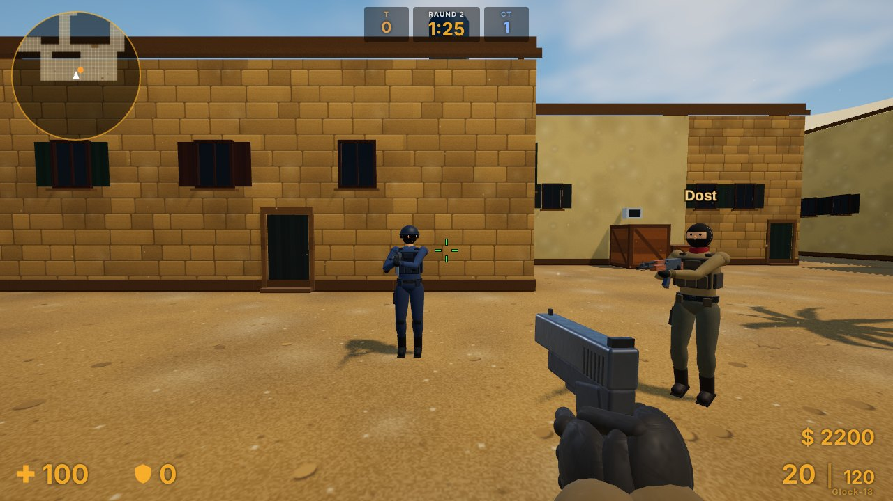
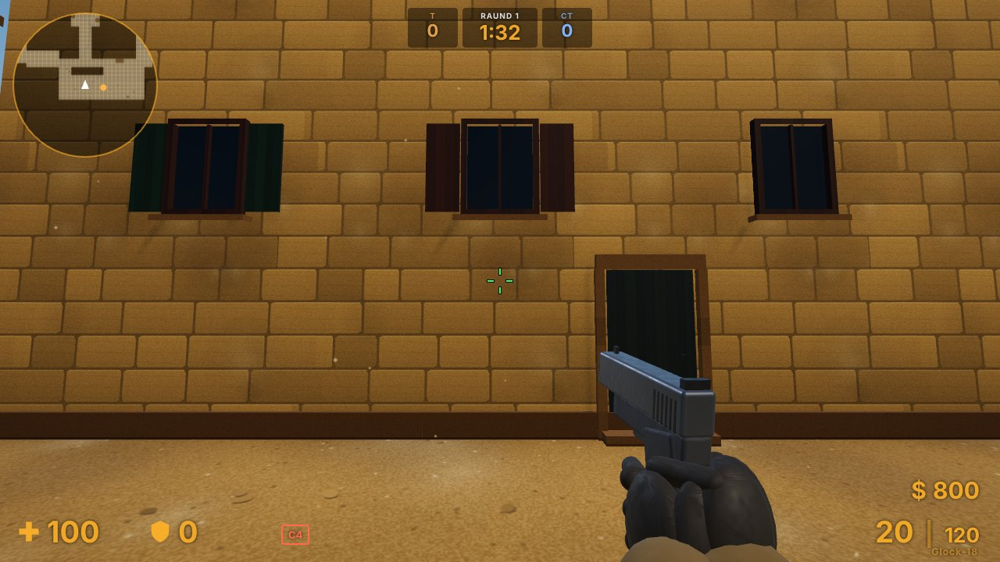
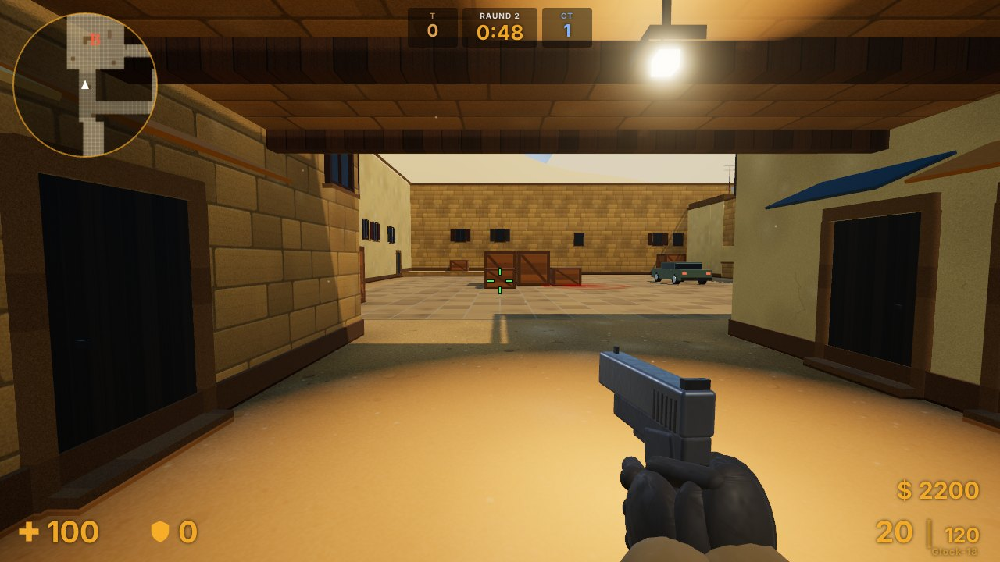
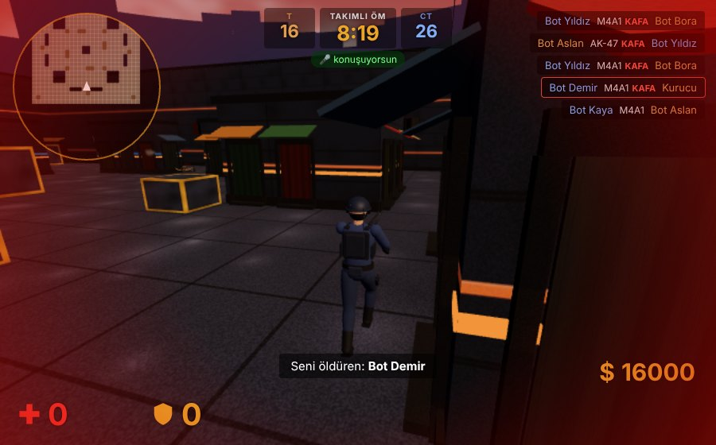
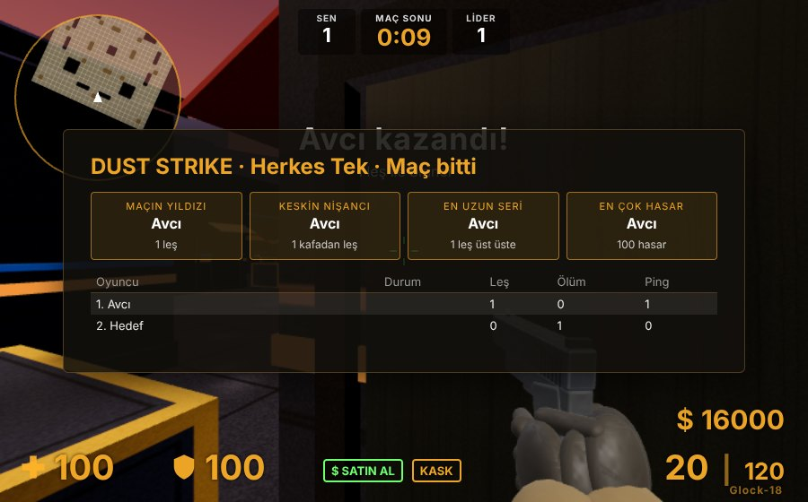
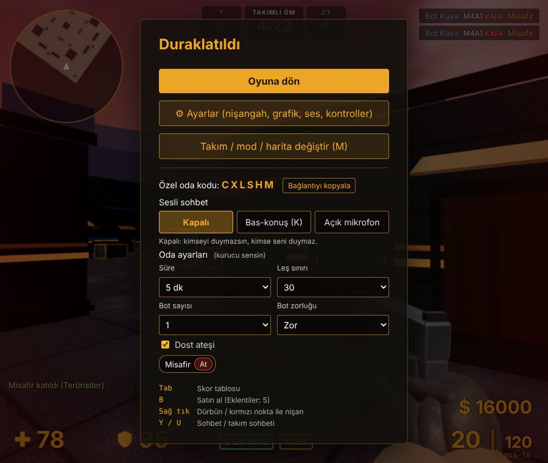

<div align="center">

# DUST STRIKE

**Tarayıcıda çalışan, çok oyunculu, CS 1.6 tarzı 3D nişancı oyunu.**
Kurulum yok, hesap yok — linke tıkla, adını yaz, oyna.

[](https://dust-strike-jqkv.onrender.com)

[](https://github.com/celikalizahid-beep/dust-strike/releases/latest/download/DustStrike.exe)
[](https://github.com/celikalizahid-beep/dust-strike/releases/latest/download/DustStrike.apk)




</div>

> **Not:** Sunucu ücretsiz planda çalışıyor. Bir süre kimse girmezse uyur; ilk giren kişi açılması için
> yaklaşık 1 dakika bekleyebilir.

## Neler var?

| | |
| --- | --- |
| 🎯 **3 oyun modu** | Klasik (bomba kur / imha et, raundlu, paralı), Takımlı Ölüm Maçı, Herkes Tek |
| 🗺️ **5 harita** | de_kum, de_serap, de_depo, de_kar ve küçük dm_arena |
| 🔫 **Silahlar ve eklentiler** | Tabancalar, tüfekler, AWP, bıçak, el bombaları · susturucu, kırmızı nokta, uzatılmış şarjör |
| 🤖 **Botlar** | Oda boşken yalnız kalmazsın · Kolay / Orta / Zor |
| 🔒 **Özel odalar** | 6 haneli kodla arkadaşlarınla · süre, leş sınırı, dost ateşi, bot ayarları |
| 🎙️ **Sesli sohbet** | Özel odalarda, bas-konuş ya da açık mikrofon |
| 🎥 **Öldüren kamerası** | Ölünce seni kimin, nereden vurduğunu görürsün |
| 💥 **Vuruş hissi** | Hasar sayıları, hasar yönü, leş serisi duyuruları, maç sonu ödülleri |
| 🎧 **Yönlü ses** | Adımlar ve silah sesleri yönüyle duyulur; duvar arkası boğuk gelir |
| 📱 **Telefonda da çalışır** | Dokunmatik kontroller, jiroskopla nişan, Android uygulaması |
| 🛡️ **Admin paneli** | Oyuncu atma, IP banlama, duyuru — tarayıcıdan |

## Ekran görüntüleri

<table>
  <tr>
    <td width="50%"><br><sub><b>de_kum</b> — klasik çöl haritası</sub></td>
    <td width="50%"><br><sub><b>Tüneller</b> — B bölgesine giden yol</sub></td>
  </tr>
  <tr>
    <td><br><sub><b>Öldüren kamerası</b></sub></td>
    <td><br><sub><b>Maç sonu</b> — ödüller ve skor tablosu</sub></td>
  </tr>
</table>

<details>
<summary><b>Özel oda ayarları</b></summary>
<br>

</details>

## Kontroller

| Tuş | İşlev |
| --- | --- |
| `W` `A` `S` `D` | Hareket · `Shift` yürü · `C` / `Ctrl` eğil · `Boşluk` zıpla |
| Sol tık / Sağ tık | Ateş / dürbün, kırmızı nokta ya da bıçak saplama |
| `1` – `5` | Ana silah, tabanca, bıçak, bombalar, C4 · `Q` son silah |
| `R` / `G` | Şarjör değiştir / silahı at |
| `B` | Satın alma menüsü |
| `E` (basılı) | Bomba kur / imha et |
| `Tab` | Skor tablosu |
| `Y` / `U` | Sohbet / takım sohbeti |
| `M` | Takım, mod, harita değiştir |
| `V` | Kendini önden gör |
| `K` (basılı) | Sesli konuş (özel odada) |
| `Esc` | Duraklat · ayarlar · oda ayarları |

Telefonda ekrandaki düğmeler kullanılır; ayrıntısı [OKUBENI.md](OKUBENI.md) içinde.

## Arkadaşlarınla oyna

1. Menüde mod ve harita seç, en altta **ODA KUR**'a bas.
2. `Esc` → **Bağlantıyı kopyala** → arkadaşına gönder.
3. Aynı menüden sesli sohbeti aç, süreyi ve leş sınırını ayarla.

## Kendi sunucunu kur

Node.js 20 ya da üstü gerekir.

```bash
git clone https://github.com/celikalizahid-beep/dust-strike.git
```

```bash
cd dust-strike
```

```bash
npm install
```

```bash
npm start
```

Sonra tarayıcıda `http://localhost:3000` adresini aç. Windows'ta `BASLAT.bat` dosyasına çift tıklamak da yeter.

İnternete açmak için depo [Render](https://render.com) ile hazır gelir (`render.yaml`): Render'da **New → Blueprint**
deyip bu depoyu seçmen yeterli. Ayrıntılı anlatım, admin paneli ve tüm ayarlar için: **[OKUBENI.md](OKUBENI.md)**.

<details>
<summary><b>Sunucu ayarları (ortam değişkenleri)</b></summary>

| Değişken | Ne işe yarar | Varsayılan |
| --- | --- | --- |
| `PORT` | Sunucunun dinlediği kapı | `3000` |
| `ADMIN_PASSWORD` | Admin paneli şifresi | ilk açılışta üretilir |
| `BOTS` | Herkese açık odalar kaç kişiye tamamlansın (`0` kapatır) | `4` |
| `BOT_SKILL` | Herkese açık odalardaki bot zorluğu (`easy` / `normal` / `hard`) | `normal` |

</details>

## Nasıl yapıldı?

- **Sunucu:** Node.js + [`ws`](https://github.com/websockets/ws). Hasar, para, raundlar ve botlar sunucuda hesaplanır.
- **İstemci:** [three.js](https://threejs.org), derleme adımı yok — dosyalar olduğu gibi sunulur.
- **Ortak kod:** Harita, fizik ve silah verileri `public/shared/` altında; sunucu ve tarayıcı aynı dosyaları kullanır.
- **Sesli sohbet:** WebRTC; ses oyuncular arasında doğrudan akar.
- **Uygulamalar:** Windows (Electron) ve Android (Capacitor) — GitHub Actions ile derlenir.

```bash
npm test
```

## Katkı

Hata bulduysan ya da fikrin varsa [bir konu aç](https://github.com/celikalizahid-beep/dust-strike/issues).

<div align="center">
<sub>DUST STRIKE bağımsız bir hayran projesidir; Valve ya da Counter-Strike ile bir bağlantısı yoktur.</sub>
</div>
